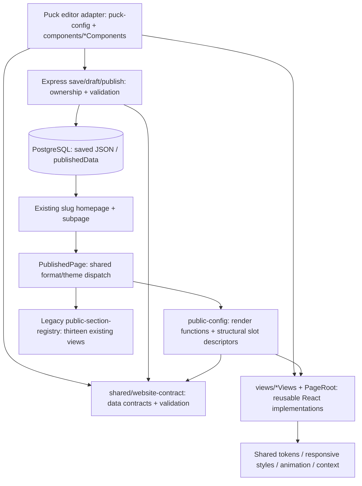

# Shared rendering architecture

`frontend/components/website-builder/components/*Components.jsx` own fields, defaults and palette-facing labels. Their render entries reference `views/*Views.jsx` functions. `puck-config.js` composes those adapters/categories/root fields. The 55 distinct view functions and PageRoot render expression are unchanged from completed M1.5 source; a committed hash baseline tests all 56 expressions. Header/Features are compatibility aliases of Navbar/FeatureCard.

`public-config.js` imports only shared views and data contracts, supplies render/defaults and minimal slot/array/object descriptors. Puck's Render needs structural fields to resolve JSON slots into React components; excluding all fields would break nested rendering. Custom field renderers, media modals, editor adapters and property controls are excluded. `PuckPublicRenderer` still uses Puck's named Render export; this is not a new renderer or a claim that upstream Puck ships a separately dependency-free bundle.

`PublishedPage` dispatches legacy/unversioned/canonical/unsupported documents and composes published theme variables. Both `app/[slug]/page.jsx` and `app/[slug]/[pageSlug]/page.jsx` share `resolvePublishedPage`, `publishedMetadata`, fetch helper and PublishedPage. Empty Puck content remains a valid Puck page, avoiding the former home/subpage disagreement. Unsupported data produces an explicit message rather than unrelated legacy fallback. Template previews also use shared format detection and the render-only registry.

Public data comes from saved `publishedData`, including site name, page metadata, theme and page list. Mutable draft names no longer override public titles/navigation branding. Existing public slugs/routes and template preview controls remain. No new host resolver/cache/domain service is enabled. Legacy snapshots remain accepted. Public failures are explicit; no publication is repaired or overwritten by rendering.

StudioContext currently supplies public page/navigation identity as well as editor context. It contains no authentication/property-panel dependencies and remains shared. Renaming/restructuring this context is unnecessary for M2. Shared views can be client components where interactivity requires hooks; Next still server-renders their initial markup. Browser navigation, animations, hydration and accessibility require credential-backed browser acceptance beyond SSR equality.

The root shared folder must accompany both applications in deployment artifacts. Next's explicit `turbopack.root` and `outputFileTracingRoot` now point at the repository root so `shared/website-contract` is resolvable/traced. No workspace install or application directory move is required. Do not copy frontend/ or backend/ alone without the sibling shared directory.

## Global layout and revision follow-up

Template globalLayout/header/footer controls remain template-only; existing website data has no website-level globalLayout column. Do not resolve live template layout when rendering a published customer website. Current Puck navigation/footer components and their nested slots render identically through both registries. Root padding/spacing, including existing 120px bottom padding, remain unchanged for compatibility.

A later additive revision model should have WebsiteRevision(id, websiteId, sequence, snapshotFormat/schema/registry versions, immutable snapshot, actor, timestamps), and Website.currentPublishedRevisionId as an atomic pointer. The snapshot must freeze metadata, pages, responsive state, chrome, theme and asset/resource references. Rollback selects an existing authorized revision; restoration creates a draft/copy without mutating a historical snapshot. Publish must validate ownership/permissions, optimistic draft version, full page set, references and versions before creating/selecting a revision atomically. Cache keys need revision IDs; hostname mappings resolve verified site/revision. Retention and deletion need product approval and migration rehearsal.

No revision Prisma model, migration, API, rollback behavior or fake applied migration was added in M2. This design is a follow-up proposal, not enabled production behavior.
